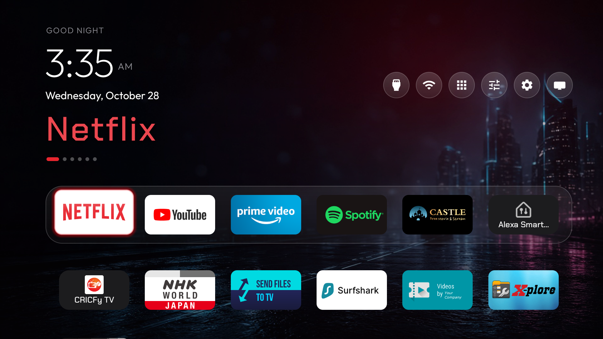
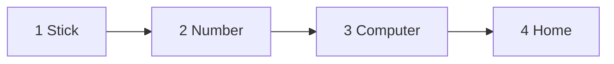

<div align="center">

# Cyber Fire TV

Press **Home**. Cyber opens.
It opens from any app.
Your apps stay. Nothing is deleted.



</div>

```text
   time                 the left side
   the big name         stays in one place while you move
   the apps             pictures only
   Home                 opens this screen, from any app
```

---

## Put it on the stick

The stick and the computer use the **same Wi-Fi**.



### 1. On the stick

```text
   Settings  →  My Fire TV  →  Developer options

   ADB debugging                  on
   Apps from Unknown Sources      on
```

Turn both of those on.

### 2. The number

```text
   Settings  →  My Fire TV  →  About  →  Network
```

Write down the address you see there.
It looks like `192.168.1.50`. Yours will be different.

### 3. On the computer

One time, on a Mac, paste this:

```sh
brew install openjdk@17
```

Then paste these three lines.
On the last line, type the address from your stick, not the example.

```sh
git clone https://github.com/RajNadiger/cyber-fire-tv.git
cd cyber-fire-tv
./install.sh 192.168.1.50
```

Wait until it finishes.

### 4. Press Home

Leave this running on the computer. Use the same address as the install.

```sh
TV_HOST=192.168.1.50 tools/venv/bin/python -I tools/tv.py 'sh /data/local/tmp/cyberhome.sh'
```

```text
   the app you are in
          │
          │  press Home
          ▼
        Cyber
```

This is the same from every app.
The **TV** button opens Amazon. Press Home to come back.

---

## The remote

```text
                    ┌─────────┐
                    │  HOME   │      opens Cyber
                    └─────────┘

                        ↑
                   ←   OK   →       move, then open
                        ↓

                    ┌─────────┐
                    │  BACK   │      leave a screen
                    └─────────┘
```

| Press | What happens |
| --- | --- |
| Left or Right | Move along a row. It stops at the ends. |
| Down | The next row. |
| Down again | Restore, Second screen, then App library. |
| Up | Back up. |

After the stick sleeps, or after you unplug it, press Home again. Cyber opens.

---

## Change an app

Open **Settings**, then **Your apps**. Pick an app.

| You want | What you do |
| --- | --- |
| A new name | **Change the name**. Type it. Press OK. |
| A new picture | **Change the picture**. Choose a photo. |
| A colour | Press a coloured dot. |
| The old look | **Put the app’s own look back**. |

**Font** changes the clock, the date, and the names together.

**Wallpaper.** In Settings, pick one picture, or a folder. Put `.jpg` or `.png` files here:

```text
Android/data/com.gathin.tvhome/files/mywallpapers
```

---

## Use the stick as a screen

Open **Second screen** on the stick.

```text
   1   same Wi-Fi
   2   paste the line below, on the computer
   3   press OK when the computer’s name appears
```

```sh
python3 tools/second-screen.py
```

One time, on a Mac: `brew install ffmpeg`.
Press Back to leave the picture.

---

## If something is wrong

| What you see | What to do |
| --- | --- |
| The computer cannot find the stick | Same Wi-Fi. Both switches on. Use the address from the stick. |
| Home still shows Amazon | The command in step 4 must still be running. Start it again. |
| An app is missing | It was switched off. It was not deleted. |

To turn those apps back on:

```sh
TV_HOST=192.168.1.50 tools/restore.sh debloat/firetv.txt com.amazon.tv.launcher
```

Use your stick’s address. The **Restore** tile only brings the old launcher back.

---

The launcher and the tools come from [CleanYourTV](https://github.com/Gathin23/cleanyourtv) by Gathin, MIT.
The clock uses [Sora](https://fonts.google.com/specimen/Sora). The titles use [Chakra Petch](https://fonts.google.com/specimen/Chakra+Petch). See `LICENSE` and `NOTICE`.
