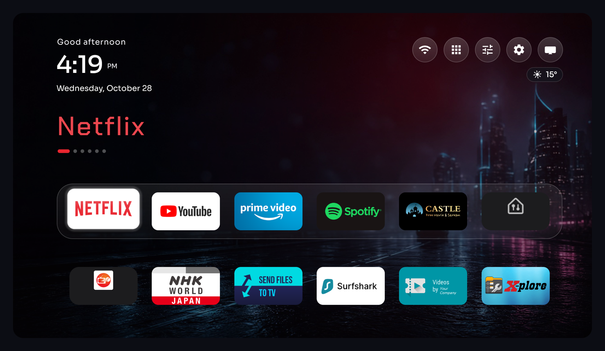
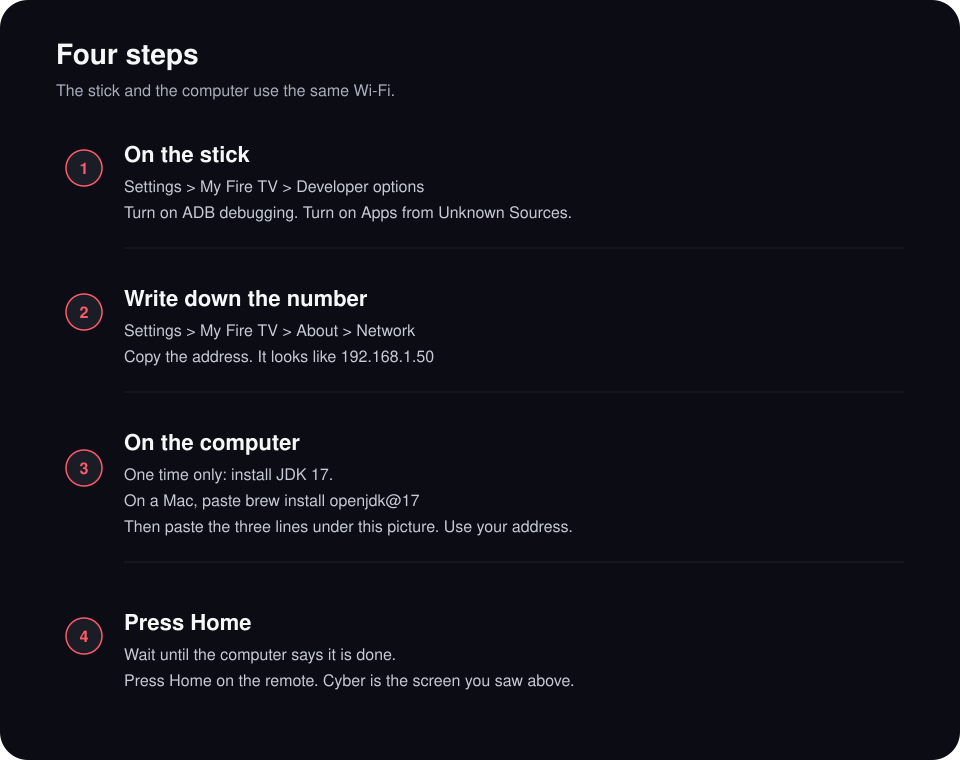
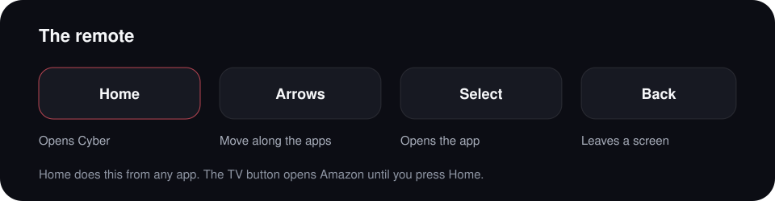
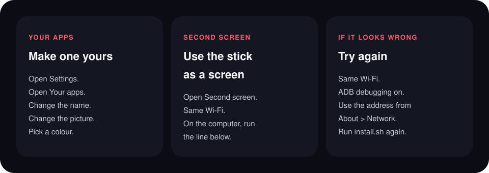

<div align="center">


<br>



<br>


<br>



</div>

### The three lines

`192.168.1.50` is an example. Use the address from the stick.

```sh
git clone https://github.com/RajNadiger/cyber-fire-tv.git
cd cyber-fire-tv
./install.sh 192.168.1.50
```

<div align="center">



<br><br>



</div>

### Second screen

On the stick, open **Second screen**. On the computer, the same Wi-Fi, with [ffmpeg](https://ffmpeg.org/) installed:

```sh
python3 tools/second-screen.py
```

On a Mac, one time: `brew install ffmpeg`. Press Select when the computer’s name appears. Back returns to the guide.

### Wallpaper

In Settings, choose one picture, or a folder that changes about once a minute. Put `.jpg` or `.png` files here:

```text
Android/data/com.gathin.tvhome/files/mywallpapers
```

### Bring an app back

Nothing is deleted. Ads go quiet. Netflix, YouTube, Prime Video, Spotify, Silk, the Appstore, Alexa, and Amazon’s own home stay.

```sh
TV_HOST=192.168.1.50 tools/restore.sh debloat/firetv.txt com.amazon.tv.launcher
```

The **Restore** tile brings the earlier launcher back. It leaves the quiet apps quiet. The line above turns those back on too.

### Credits

The launcher, the tools, and the safety rules come from [CleanYourTV](https://github.com/Gathin23/cleanyourtv) by Gathin, MIT.

The clock uses [Sora](https://fonts.google.com/specimen/Sora). The theme title face is [Chakra Petch](https://fonts.google.com/specimen/Chakra+Petch). Both are under the SIL Open Font License. See `LICENSE` and `NOTICE`.
