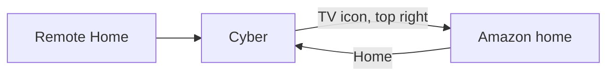
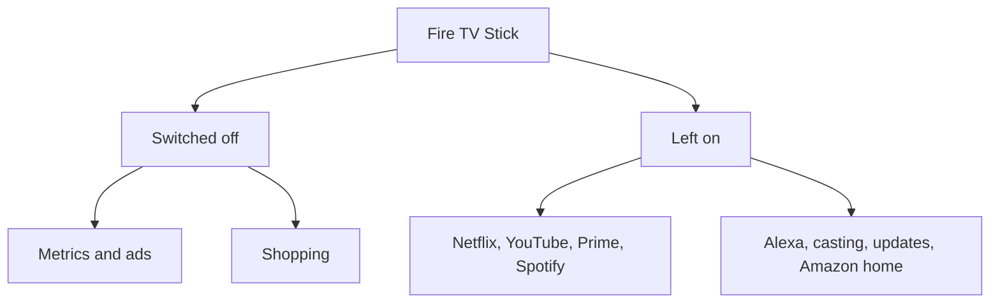

# Cyber

A Fire TV home that stays quiet. Ads and telemetry are switched off, not deleted. The Home button opens this launcher. Amazon’s own home is one tap away.


Built on [CleanYourTV](https://github.com/Gathin23/cleanyourtv) (MIT). The launcher is `com.gathin.tvhome`. Fire OS keeps Amazon’s launcher installed. Cyber sits in front of it.

## Install

On the Fire TV: **Settings → My Fire TV → Developer options → ADB debugging** and **Apps from Unknown Sources**.

On your computer, with [JDK 17](https://adoptium.net/) installed:

```sh
git clone https://github.com/RajNadiger/cyber-fire-tv.git
cd cyber-fire-tv
./install.sh 192.168.1.50
```

Use your stick’s address. That one command turns off the ad packages, builds Cyber, installs it, and points Home at it.

## What you get



| Piece | What it does |
| --- | --- |
| Home | Opens Cyber, including after a full shutdown |
| TV icon | Opens Amazon’s home and leaves it there |
| Style | Layout, wallpaper, motion, and look, with a live preview |
| Wallpaper folder | `Android/data/com.gathin.tvhome/files/mywallpapers` |
| Restore | The Restore app puts the original launcher back |

The top row is Netflix, YouTube, Prime Video, Spotify, Silk, and the Appstore when those apps are installed. Change the list in `themes/cyberpunk/config.json`.

## Ads and telemetry

Packages are disabled for the current user. They are not uninstalled. Alexa, casting, the Appstore, Live TV, and firmware updates stay on.



The list is `debloat/firetv.txt`. Put one package back with:

```sh
TV_HOST=192.168.1.50 tools/venv/bin/python -I tools/tv.py 'pm enable --user 0 com.amazon.bueller.music'
```

Undo the whole list:

```sh
TV_HOST=192.168.1.50 tools/restore.sh debloat/firetv.txt com.amazon.tv.launcher
```

## Your pictures

Put `.jpg` or `.png` files in `mywallpapers` with a file manager on the stick. In **Style → Wallpaper**:

- **Change automatically** walks that folder about once a minute
- **Choose one** keeps a single picture
- **Theme default** returns to the built-in night scene

## Why Home still mentions Amazon

Fire OS will not let another app become the official Home app. Cyber watches for Amazon’s home and for the Home button, then opens itself again. After you press Home, Amazon’s screen can stay up for a few seconds. Cyber replaces it. The same thing happens after a restart.

## Credits

The launcher, the disable tools, and the safety rules come from [CleanYourTV](https://github.com/Gathin23/cleanyourtv) by Gathin, MIT. This repo is a Fire TV setup on top of that project: the night theme, the Home helper for Fire OS, the wallpaper folder, and the settings preview.

The title face is [Chakra Petch](https://fonts.google.com/specimen/Chakra+Petch), SIL Open Font License. The clock face is Outfit, also OFL. See `LICENSE`.
