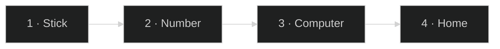

<div align="center">

# Cyber Fire TV

Press **Home**. Cyber opens, from any app.
Your apps stay. Nothing is deleted.


<sub>Time on the left. The name stays still. Pictures only. Home does this from every app.</sub>

</div>

---

## The path



The stick and the computer sit on the **same Wi-Fi**.

```text
        your computer                         Fire TV Stick
   ┌──────────────────┐                  ┌──────────────────┐
   │                  │                  │                  │
   │   ./install.sh   │    same Wi-Fi    │  two switches    │
   │                  │ ───────────────► │  one address     │
   │                  │                  │                  │
   └──────────────────┘                  └──────────────────┘
            │                                      │
            │   ads go quiet                       │
            │   Cyber is built                     │
            │   the night look goes on             ▼
                                            press Home
```

### 1 · On the stick

```text
   Settings  →  My Fire TV  →  Developer options

        ADB debugging                 ● on
        Apps from Unknown Sources    ● on
```

### 2 · The number

```text
   Settings  →  My Fire TV  →  About  →  Network

        write this down
        192 . 168 . 1 . 50          an example, not yours
```

### 3 · On the computer

One time, on a Mac:

```sh
brew install openjdk@17
```

Then these three lines. Put **your** address on the last line.

```sh
git clone https://github.com/RajNadiger/cyber-fire-tv.git
cd cyber-fire-tv
./install.sh 192.168.1.50
```

### 4 · Press Home

```text
   any app you are in
          │
          │   Home
          ▼
        Cyber
```

Netflix, a game, the Appstore, Settings, Amazon’s own home. Same button.

The **TV** button opens Amazon. It stays until you press Home again.

---

## What you see

```text
┌────────────────────────────────────────────────────────────┐
│  Good afternoon                         weather · buttons  │
│  4:19                                                      │
│  Wednesday                                                 │
│                                                            │
│  Netflix              the name stays on this line          │
│  ━ · · · · ·          the mark moves, the name does not    │
│                                                            │
│   ▢   ▢   ▢   ▢   ▢   ▢      pictures. no words on them    │
│                                                            │
│    ▢   ▢   ▢   ▢   ▢   ▢     the next row, fully on screen │
└────────────────────────────────────────────────────────────┘
```

| You look at | It means |
| --- | --- |
| Greeting, clock, date | The time of day. |
| Large name | The app you have selected. It does not jump as you move. |
| Line and dots | Where you are in the row. |
| Glass row | Your main apps. Press the centre to open one. |
| Row under it | The next apps. No names under those pictures. |
| Round buttons | Wi-Fi, apps, settings. The one you are on shows its name. |
| **TV** | Amazon’s home, until you press Home. |

---

## The remote

```text
                         ┌─────────┐
                         │  HOME   │     Cyber, from any app
                         └─────────┘

                             ↑
                        ←   OK   →        move, then open
                             ↓

                         ┌─────────┐
                         │  BACK   │
                         └─────────┘
```

```text
   left / right      along a row, and stop at the ends
   down              one row lower, same column
   down again        Restore, Second screen, then App library
   up                back the way you came
```

```text
   unplug  →  plug in  →  turn the TV on  →  press Home  →  Cyber
   sleep   →  wake                         →  press Home  →  Cyber
```

---

## Make an app yours

Open **Settings**, then **Your apps**.

```text
   Netflix
   YouTube
   Prime Video   ▶  ──►   name
   Spotify                 picture
                           colour
```

| You want | What you do |
| --- | --- |
| A different name | **Change the name**, type it, press OK. |
| Your own picture | **Change the picture**, and choose a photo. |
| A colour for the name | Press one of the coloured dots. |
| The app’s own look back | **Put the app’s own look back**. |

**Font** changes the clock, the date, and the names together.

**Wallpaper** is one picture, or a folder that changes about once a minute. Put `.jpg` or `.png` files here:

```text
Android/data/com.gathin.tvhome/files/mywallpapers
```

---

## Second screen

Open **Second screen** on the stick. The screen itself is the guide.

```text
   1   same Wi-Fi
   2   python3 tools/second-screen.py
   3   the computer’s name appears  →  press OK
```

One time, on a Mac: `brew install ffmpeg`. Back leaves the picture.

---

## If it looks wrong

| What you see | What to do |
| --- | --- |
| The computer cannot find the stick | Same Wi-Fi. Both switches on. The address from About → Network. |
| Home still shows Amazon | Press Home again. If it never changes, run `./install.sh` again. |
| An app is missing | It was switched off, not deleted. |

Nothing is deleted. Ads go quiet. The apps you use stay, and so does Amazon’s own home.

```sh
TV_HOST=192.168.1.50 tools/restore.sh debloat/firetv.txt com.amazon.tv.launcher
```

The **Restore** tile brings the earlier launcher back. The line above turns the quiet apps back on too.

---

## Credits

The launcher, the tools, and the safety rules come from [CleanYourTV](https://github.com/Gathin23/cleanyourtv) by Gathin, MIT.

The clock uses [Sora](https://fonts.google.com/specimen/Sora). The theme title face is [Chakra Petch](https://fonts.google.com/specimen/Chakra+Petch). Both are under the SIL Open Font License. See `LICENSE` and `NOTICE`.

<div align="center">

```text
   Home   →   Cyber   →   your apps
   TV     →   Amazon, until you press Home again
```

</div>
