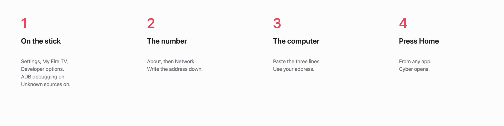

# Cyber Fire TV

Press **Home**. Cyber opens, from any app.
Your apps stay. Nothing is deleted.

<p align="center">
  
</p>

<p align="center">
  
</p>

The stick and the computer use the same Wi-Fi.

On a Mac, one time:

```sh
brew install openjdk@17
```

`192.168.1.50` is an example. Use the address from the stick.

```sh
git clone https://github.com/RajNadiger/cyber-fire-tv.git
cd cyber-fire-tv
./install.sh 192.168.1.50
```

The **TV** button opens Amazon. Home brings Cyber back.

**Your apps.** Settings, then Your apps. Change the name, the picture, or the colour.

**Second screen.** Open Second screen on the stick. On the computer, same Wi-Fi. One time on a Mac: `brew install ffmpeg`.

```sh
python3 tools/second-screen.py
```

**Wallpaper.** One picture, or a folder that changes about once a minute. Put `.jpg` or `.png` files in `Android/data/com.gathin.tvhome/files/mywallpapers`.

**If it fails.** Same Wi-Fi. Both switches on. The address from the stick. Run `./install.sh` again.

Nothing is deleted. Ads go quiet. The apps you use stay, and so does Amazon’s own home.

```sh
TV_HOST=192.168.1.50 tools/restore.sh debloat/firetv.txt com.amazon.tv.launcher
```

The **Restore** tile brings the earlier launcher back. The line above turns the quiet apps back on too.

The launcher, the tools, and the safety rules come from [CleanYourTV](https://github.com/Gathin23/cleanyourtv) by Gathin, MIT. The clock uses [Sora](https://fonts.google.com/specimen/Sora). The theme title face is [Chakra Petch](https://fonts.google.com/specimen/Chakra+Petch). See `LICENSE` and `NOTICE`.
